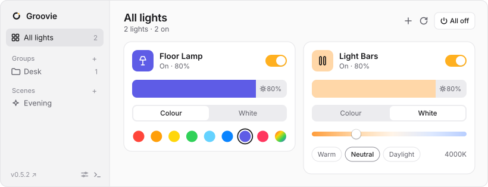

<div align="center">

<picture>
  <source media="(prefers-color-scheme: dark)" srcset="docs/logo-dark.svg" />
  
</picture>

<p>
  Local-first Govee light control for Windows, macOS &amp; Linux — desktop tray app + <code>grooviectl</code> CLI.<br />
  No account, no cloud, instant two-way LAN sync.
</p>

<p>
  <a href="https://github.com/rudyorre/groovie/releases/latest"><b>Download</b></a>
  &nbsp;·&nbsp;
  <a href="#setup">Setup</a>
  &nbsp;·&nbsp;
  <a href="#command-line">CLI</a>
  &nbsp;·&nbsp;
  <a href="#configuration">Configuration</a>
  &nbsp;·&nbsp;
  <a href="#development">Development</a>
</p>

<picture>
  <source media="(prefers-color-scheme: dark)" srcset="docs/preview-dark.svg" />
  
</picture>

</div>

<br />

**Groovie** talks directly to Wi-Fi Govee lights over your local network using Govee's official UDP LAN API:

- **Direct control:** power, brightness, RGB colour, and white colour temperature (`2000K–9000K`)
- **Two-way LAN sync:** changes made in the Govee mobile app sync back automatically without cloud polling
- **Groups & scenes:** control rooms together (e.g. "Desk") and snapshot saved looks (e.g. "Evening")
- **Lightweight tray app + CLI:** native Tauri desktop app for Windows, macOS, and Linux, plus `grooviectl` for scripts and keybindings

> Groovie is an independent open-source project and is not affiliated with or endorsed by Govee.

## Download

Grab the latest installer from [**Releases**](https://github.com/rudyorre/groovie/releases/latest):

- **Windows:** `Groovie_x.y.z_x64-setup.exe` (or `.msi`)
- **macOS:** `Groovie_x.y.z_universal.dmg` (Apple Silicon & Intel)
- **Linux:** `Groovie_x.y.z_amd64.AppImage` or `.deb`

**In-app updates:** when a new release is published, Groovie shows an **Update** button in the sidebar that downloads, verifies, installs, and relaunches in one click.

Notes on first launch (builds are not OS-notarized yet):
- **Windows:** if SmartScreen says *"Windows protected your PC"*, click **More info → Run anyway**.
- **macOS:** if Gatekeeper blocks opening, drag `Groovie.app` to Applications and run `xattr -cr /Applications/Groovie.app` once.
- **Firewall:** allow Groovie on **private** networks when prompted (UDP ports `4001–4003`).

## Setup

Each light must join your Wi-Fi once in the official Govee Home app. Then open the light in the Govee app → **Settings** (gear) → enable **LAN Control**, and make sure your computer is on the same network.

Tested hardware includes `H6072` (Floor Lamp) and `H6056` (Light Bars); most Wi-Fi Govee lights with a **LAN Control** toggle work out of the box.

## Command line

```sh
grooviectl list                           # discover lights and print status
grooviectl on all
grooviectl color "Floor Lamp" "#5e5ce6"
grooviectl kelvin "Light Bars" 4000
grooviectl brightness all 80
grooviectl group create Desk "Light Bars"
grooviectl scene save Evening
grooviectl scene apply Evening
grooviectl add-ip 192.168.1.50            # add a light directly if multicast is blocked
grooviectl config                         # print active groovie.json path (--json for contents)
```

Targets accept a light's nickname, IP, or device ID, a group name, or `all`. Run `grooviectl --help` for full usage.

## Configuration

Nicknames, groups, scenes, and known devices are stored in plain, deterministic JSON (`groovie.json`) designed to play nicely with dotfiles:

- **Default locations:** `%APPDATA%\groovie\groovie.json` on Windows, `~/Library/Application Support/groovie/groovie.json` on macOS, and `~/.config/groovie/groovie.json` on Linux.
- **Cross-OS dotfiles:** if `~/.config/groovie/groovie.json` exists on Windows or macOS, Groovie uses it automatically.
- **Symlink & custom-path friendly:** atomic saves follow symlinks (`ln -s`, `stow`, `chezmoi`) instead of replacing them, or you can point Groovie at any path from the **Configuration** button in the sidebar footer (or via `GROOVIE_CONFIG=/path/to/groovie.json`). External edits reload automatically when you focus the app.

## Troubleshooting

- **No lights found:** confirm **LAN Control** is enabled, your computer and lights are on the same Wi-Fi (not a guest VLAN), and your firewall allows Groovie. If your router blocks multicast, click **+** (**Add light by IP**) or run `grooviectl add-ip <ip>`.
- **Port 4002 busy:** Govee Desktop and SignalRGB also bind UDP port `4002` — close them while running Groovie.
- **Packet & state logs:** click the terminal (`>_`) button in the bottom-right of the sidebar to inspect live UDP traffic and state transitions (or run `GROOVIE_LOG=debug grooviectl list` in the terminal).

## Development

| Path | Description |
|---|---|
| `crates/groovie-core` | Rust library: UDP LAN protocol, discovery, state sync, groups, scenes, `groovie.json` store |
| `crates/groovie-sim` | Simulated Govee LAN lights over real UDP for local testing without hardware |
| `crates/grooviectl` | Command-line interface |
| `ui/` | Svelte 5 + Vite frontend (runs standalone in a browser with mock lights via `npm run dev`) |
| `apps/desktop/` | Tauri 2 desktop shell + system tray + auto-updater |

Prerequisites: [Rust](https://rustup.rs), [Node.js](https://nodejs.org) 20+, and platform [Tauri v2 dependencies](https://v2.tauri.app/start/prerequisites/).

```sh
cargo test --workspace                    # unit + simulated UDP integration tests
cargo run -p grooviectl -- list           # run CLI against local lights

cd ui && npm install && npm run dev       # browser UI with mock lights

cd apps/desktop && npm install            # installs desktop + UI dependencies
npm run dev                               # desktop app with hot reload
npm run build                             # native installer in src-tauri/target/release/bundle
```

To test without physical lights on Linux, run `cargo run -p groovie-sim -- --count 3` in one terminal and launch Groovie or `grooviectl` with `GROOVIE_SCAN_TARGETS=127.0.0.2:4001,127.0.0.3:4001,127.0.0.4:4001`.

## License

Dual-licensed under [MIT](LICENSE-MIT) or [Apache-2.0](LICENSE-APACHE), at your option.
